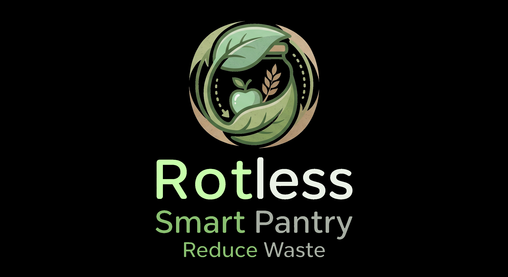

<p align="center">
  
</p>

# rotless

Smart pantry web app — *"rot less"* (less food waste). Tracks household food batches and expiry dates, warning members via Telegram before food expires.

## Stack

- **Backend:** PHP 8.3 + Laravel (REST API only, `/api/v1/*`)
- **Frontend:** React + TypeScript + Vite (`frontend/`)
- **Database:** PostgreSQL
- **Infra:** Docker Compose (`app`, `db`, `queue`, `scheduler`)
- **Auth:** Laravel Sanctum (token-based)

## Quick start

```bash
docker compose up -d
docker compose exec app composer install
docker compose exec app php artisan migrate
```

## Local dev

```bash
cd frontend
npm install
npm run dev
```

`npm run dev` starts the Docker stack (`app`, `db`, `queue`, `scheduler`) when it
is not already running, waits for the API health check, then starts the Vite dev
server. When you stop it (Ctrl+C), it stops the stack again — but only if it was
the one that started it; a stack that was already running is left untouched.
Requires Docker and `docker-compose.yml` one level above `frontend/`.

## Install on Android (PWA)

The frontend is an installable PWA (`vite-plugin-pwa`). Open the production
URL in Chrome on Android and tap **⋮ → Instalar app** (or the install banner).
It gets a home-screen icon and opens standalone, without the browser UI. The
service worker caches only the app shell; API calls always hit the network.
The service worker is generated only by `npm run build`, not by `npm run dev`.

## Deploy

rotless is published with [devkit](https://github.com/krosct/devkit), like the other apps on
its VPS, which all sit behind one shared Caddy. `deploy.conf` holds what is specific to rotless;
devkit does the rest.

Pushes to `main` that pass CI are deployed by `.github/workflows/deploy.yml`, **after a manual
approval** of the `production` environment in GitHub Actions. devkit builds the frontend on the
runner, sends the release over SSH and, on the VPS, in `/srv/rotless`:

1. unpacks it into `releases/<release>` and runs `INSTALL` (`deploy.conf`) while the running
   release keeps serving: builds the image `rotless-app:<release>`, dumps the database into
   `data/backups/` (newest 10 kept) and runs pending migrations (additive only);
2. switches the user service `rotless` to the new release: `RUN` recreates `app`, `queue`,
   `scheduler` and `caddy` on the new image, whose code they run (`docker-compose.prod.yml`;
   the database keeps running);
3. checks that it stays up and answers `GET /api/v1/health`, or goes back to the previous
   release (migrations are never rolled back);
4. publishes `rotless.caddy` on the shared Caddy (`/srv/caddy/sites/`, HTTPS with the
   Cloudflare Origin Certificate in `/srv/caddy/certs/`), which forwards to the `caddy`
   container on the port devkit chose, and checks the public address.

What stays on the VPS across releases: `/srv/rotless/.env` (the settings; the workflow sends
none), `/srv/rotless/data/storage` (Laravel's storage), `data/backups` and the database volume
`rotless_db-data` (the Compose project is always `rotless`). On a VPS without the shared Caddy,
the first deploy installs it (passwordless sudo, or run it from a terminal).

### Secrets of the `production` environment

`DEPLOY_HOST` (the VPS IP, a secret so it stays masked in the public Actions logs),
`DEPLOY_USER`, `DEPLOY_SSH_KEY` (a key with a shell on the VPS: devkit runs its own steps there)
and `DEPLOY_KNOWN_HOSTS`:

```bash
ssh rotless-vps 'cat /etc/ssh/ssh_host_ed25519_key.pub' \
  | awk -v h="<VPS IP>" '{print h, $1, $2}' \
  | gh secret set DEPLOY_KNOWN_HOSTS --env production
```

A non-default SSH port goes in the `DEPLOY_PORT` environment variable.

### Manual deploy and helpers

```bash
~/Documentos/devkit/deploy.sh vps rotless-vps            # same deploy, from this folder
~/Documentos/devkit/deploy.sh status|logs|restart rotless-vps
```

Stopping the service only stops following the logs; the containers keep running. To stop
rotless: `ssh rotless-vps 'docker compose -p rotless stop'`. To undo a release, `git revert` it
on `main` and let it deploy. Never run `docker compose down -v`: it deletes the database volume.
